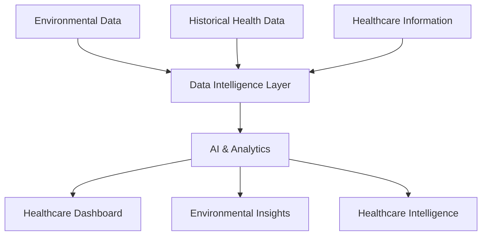

# 🏥 Aarogya-Connect
### Connecting Healthcare. Predicting Risks. Empowering Communities.

<p align="center">
  <strong>🌍 Smarter Healthcare • 🤖 AI-Powered Insights • 📊 Data-Driven Decisions</strong>
</p>

<p align="center">
  
  
  
  
  
</p>

---

## 💡 The Idea Behind Aarogya-Connect

**What if healthcare could identify risks before they become emergencies?**

Aarogya-Connect is an AI-powered healthcare intelligence platform designed to bridge the gap between environmental conditions, disease-risk awareness, and healthcare accessibility.

It brings together environmental intelligence, healthcare data, and AI-driven insights to support smarter public-health monitoring and more informed decision-making.

**Because healthcare shouldn't just react to diseases. It should help us anticipate them.**

## ✨ What Makes It Interesting?

| Capability | What it brings to the table |
|---|---|
| 🌦️ Environmental Intelligence | Connects meteorological and environmental indicators with public-health risk analysis. |
| 🧠 AI-Powered Intelligence | Uses Google's Gemini ecosystem to support intelligent application experiences. |
| 🗺️ Pollution Awareness | Integrates air-quality information to support location-aware environmental insights. |
| 🏥 Healthcare Connectivity | Explores integration with India's healthcare information ecosystem, including IHIP/ABDM-related workflows. |
| 📊 Data Visualization | Presents information through interactive dashboards and visual analytics. |
| 🚑 Healthcare Accessibility | Incorporates healthcare-facility discovery and PHC queue optimization workflows. |

## 🧠 The Engineering Behind the Idea

The interesting part isn't simply using AI — it's **how different data sources are handled.**

Aarogya-Connect follows a separation-of-data approach:

- **Historical Intelligence:** Historical datasets support machine-learning-based risk analysis.
- **Live Environmental Intelligence:** Current meteorological and pollution information provides real-time environmental context.
- **Healthcare Intelligence:** Public-health reporting and healthcare information contribute to a broader understanding of local health conditions.

Keeping historical model inputs separate from live environmental signals helps avoid temporal data leakage and misleading predictions.

## ⚙️ Tech Stack

| Layer | Technologies |
|---|---|
| Frontend | React 19, TypeScript, Vite |
| Styling | Tailwind CSS |
| Backend | Node.js, Express |
| Database & Cloud | Firebase, Firestore |
| AI Integration | Google Gemini API |
| Data Visualization | Recharts, Mermaid |
| UI & Animation | Lucide React, Motion |

## 🏗️ Architecture at a Glance



## 🚀 Getting Started

### Prerequisites

- Node.js
- npm
- Firebase configuration
- Google Gemini API key

### 1. Clone the repository

```bash
git clone https://github.com/Chaitan231/Aarogya-Connect.git
cd Aarogya-Connect
```

### 2. Install dependencies

```bash
npm install
```

### 3. Configure environment variables

Create a `.env.local` file in the root directory:

```env
GEMINI_API_KEY=your_gemini_api_key
APP_URL=http://localhost:5000
```

Use your actual application URL and configure any additional Firebase credentials required by your environment. Never commit real API keys or secrets.

### 4. Run the application

```bash
npm run dev
```

### 5. Build for production

```bash
npm run build
```

## 🔬 Why This Project Matters

Aarogya-Connect explores an important intersection of modern technology:

- Artificial Intelligence
- Environmental Health Intelligence
- Public Healthcare Infrastructure
- Real-Time Data Integration
- Scalable Cloud-Based Applications

It is an attempt to move beyond isolated healthcare tools and explore how connected information systems can contribute to more proactive public healthcare.

## 🔮 What's Next?

- Enhanced disease-risk prediction models.
- Deeper integration with public-health information systems.
- Improved geographical risk visualization.
- Expanded healthcare-facility discovery.
- More robust model evaluation and validation.

## 👨‍💻 Built With Purpose

**Aarogya-Connect** is built around one belief:

> Technology is most powerful when it solves problems that genuinely matter to people.

If you're interested in AI, healthcare technology, environmental intelligence, or building impactful real-world applications, let's connect!

⭐ If you find this project interesting, consider giving it a star.

**Repository:** [Aarogya-Connect](https://github.com/Chaitan231/Aarogya-Connect)

---

<p align="center">
  <strong>💚 Aarogya-Connect — Better Insights. Better Decisions. Healthier Communities.</strong>
</p>
